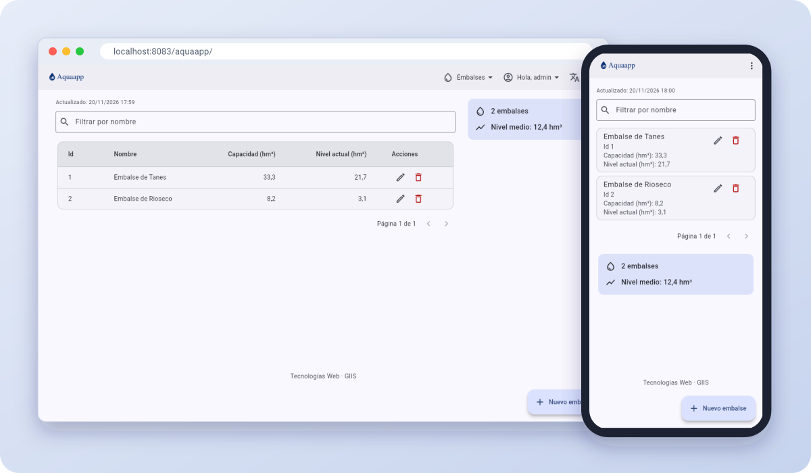
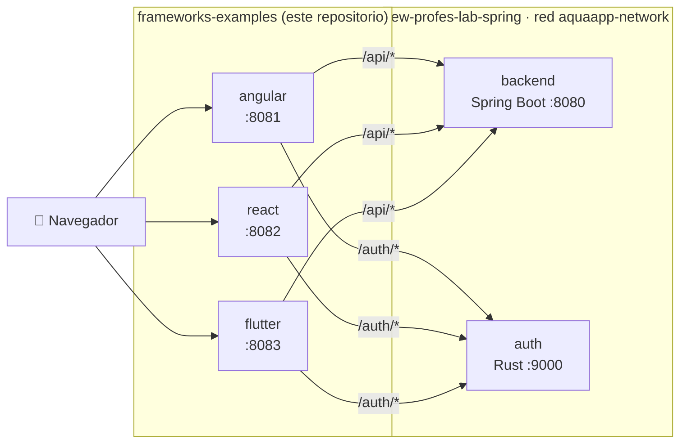

<p align="center">
  
  &nbsp;&nbsp;&nbsp;&nbsp;
  
</p>

# aquaapp con distintos frameworks — Tecnologías Web

Un mismo cliente web, **tres implementaciones**. Este repositorio contiene el cliente de *aquaapp* (gestión de
embalses) reescrito en **Angular**, **React** y **Flutter**, con las mismas funcionalidades y la misma API: login y
registro con JWT, CRUD de embalses con filtro y paginación, panel de indicadores, selector de idioma (es/en) y
tratamiento de errores `401` y `403`. Cada variante usa los componentes e iconos propios de su ecosistema, para que
parezca una aplicación nativa de ese framework.

Las tres consumen el backend de [`tew-profes-lab-spring`](https://github.com/tew-uniovi/tew-profes-lab-spring)
(servicio de autenticación en Rust y API REST en Spring Boot), al que se conectan a través de una red de Docker
compartida.

Estos son los clientes disponibles:

- **[Angular](aquaapp-frontend-angular/README.md)** — Angular 22 + Angular Material (Material 3) · `http://localhost:8081/aquaapp/`
- **[React](aquaapp-frontend-react/README.md)** — React 19 + Vite + Material UI · `http://localhost:8082/aquaapp/`
- **[Flutter](aquaapp-frontend-flutter/README.md)** — Flutter Web + Material 3 · `http://localhost:8083/aquaapp/`

---

## Angular

<p align="center">
  
</p>

## React

<p align="center">
  
</p>

## Flutter

<p align="center">
  
</p>

---

## Arquitectura

Cada cliente es una imagen de **nginx** que sirve la aplicación compilada bajo `/aquaapp/` y reenvía `/api/*` al
backend y `/auth/*` al servicio de autenticación, de modo que el navegador siempre habla con un único origen (sin
CORS). Todos los contenedores comparten la red `aquaapp-network`, que crea el `docker-compose.yml` de
`tew-profes-lab-spring`.



## Puesta en marcha

Hace falta [Docker](https://docs.docker.com/get-docker/) con Compose. Primero se arranca el backend, que crea la red
compartida, y después los tres clientes:

```bash
# 1. Backend y autenticación (repositorio tew-profes-lab-spring): crea la red aquaapp-network
cd ../tew-profes-lab-spring
docker compose up -d --build

# 2. Los tres clientes de este repositorio, cada uno en su puerto
cd ../frameworks-examples
docker compose up -d --build
```

| Cliente | URL | Puerto | Variable |
|---|---|---|---|
| Angular | http://localhost:8081/aquaapp/ | `8081` | `ANGULAR_PORT` |
| React | http://localhost:8082/aquaapp/ | `8082` | `REACT_PORT` |
| Flutter | http://localhost:8083/aquaapp/ | `8083` | `FLUTTER_PORT` |

Se puede arrancar solo una variante (`docker compose up -d --build react`). Los puertos, el nombre de la red
(`AQUAAPP_NETWORK`) y los destinos del proxy (`BACKEND_URL`, `AUTH_URL`) se cambian con un fichero `.env`; hay un
ejemplo en [`.env.example`](.env.example).

Usuarios de prueba del servicio de autenticación:

| Usuario | Contraseña | Rol |
|---|---|---|
| `ana` | `1234` | `USER` (solo lectura) |
| `admin` | `admin` | `ADMIN` (puede crear, editar y borrar) |

## Estructura del repositorio

```
📁 frameworks-examples/
├── 📁 aquaapp-frontend-angular/   # Angular + Angular Material
├── 📁 aquaapp-frontend-react/     # React + Vite + Material UI
├── 📁 aquaapp-frontend-flutter/   # Flutter Web + Material 3
├── 📁 .github/
│   └── 📄 dependabot.yml          # actualizaciones mensuales de dependencias e imágenes de Docker
├── 📄 docker-compose.yml          # despliega los tres clientes en la red aquaapp-network
└── 📄 .env.example
```

## Dependencias

[Dependabot](.github/dependabot.yml) revisa cada mes las dependencias de cada cliente (`npm` y `pub`) y las
imágenes base de sus Dockerfile. Los PRs se asignan a `augustocristian` y se etiquetan por framework (`angular`,
`react`, `flutter`) y por lenguaje (`ts`, `js`, `dart`, `docker`). Las subidas menores y de parche se agrupan en un
solo PR por carpeta para evitar conflictos entre ellos.

## ¿Tienes algún problema?

Si encuentras un error o tienes alguna duda, [**abre una issue**](https://github.com/tew-uniovi/frameworks-examples/issues/new).

---

<p align="center">
  
  &nbsp;Tecnologías Web - Grado en Ingeniería Informática de Tecnologías de la Información
</p>
