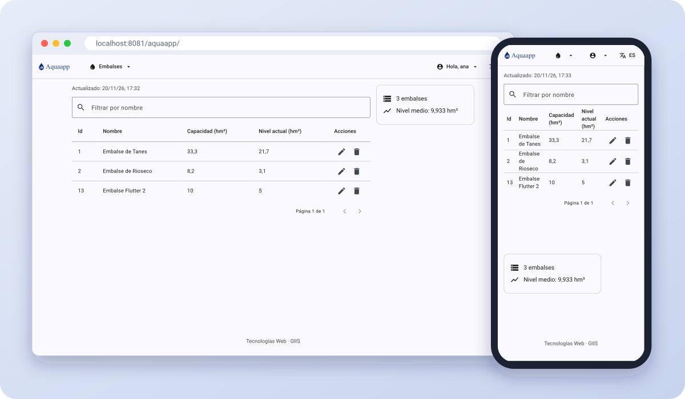
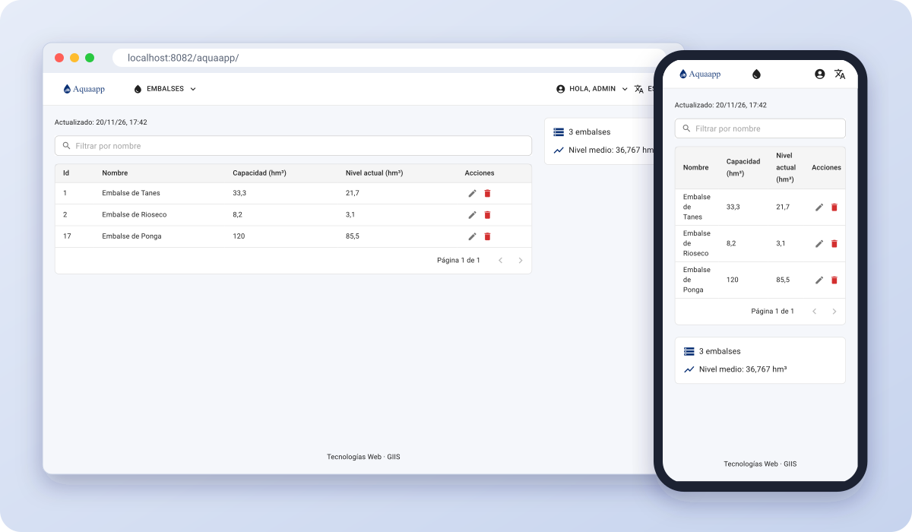
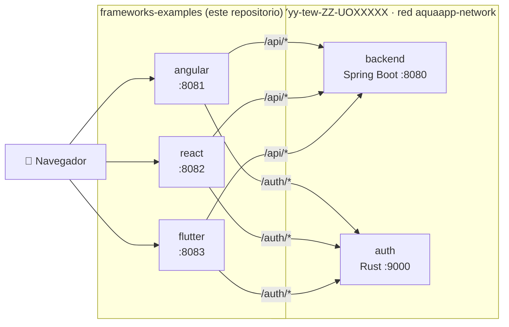

<p align="center">
  
</p>

# Aquaapp con distintos frameworks — Tecnologías Web

Un mismo cliente web, **tres implementaciones**. Este repositorio contiene el cliente de *aquaapp* (gestión de
embalses) reescrito en **Angular**, **React** y **Flutter**, con las mismas funcionalidades y la misma API: login y
registro con JWT, CRUD de embalses con filtro y paginación, panel de indicadores, selector de idioma (es/en) y
tratamiento de errores `401` y `403`. Cada variante usa los componentes e iconos propios de su ecosistema, para que
parezca una aplicación nativa de ese framework.

Las tres consumen el backend de la práctica (servicio de autenticación en Rust y API REST en Spring Boot), que vive
en tu repositorio `YYyy-tew-ZZ-UOXXXXX`, y se conectan a él a través de una red de Docker compartida.

> `YYyy-tew-ZZ-UOXXXXX` es la plantilla del nombre del repositorio del backend: `YYyy` son el año del curso y el
> siguiente, `ZZ` el número de PL (`01`, `02`, `03`...) y `UOXXXXX` tu UO. Por ejemplo, `2627-tew-01-UO123456`.

Estos son los clientes disponibles:

- **[Angular](aquaapp-frontend-angular/README.md)** — Angular 22 + Angular Material (Material 3) · `http://localhost:8081/aquaapp/`
- **[React](aquaapp-frontend-react/README.md)** — React 19 + Vite + Material UI · `http://localhost:8082/aquaapp/`
- **[Flutter](aquaapp-frontend-flutter/README.md)** — Flutter Web + Material 3 · `http://localhost:8083/aquaapp/`

---

## Angular

<p align="center">
  
</p>

## React

<p align="center">
  
</p>

## Flutter

<p align="center">
  
</p>

---

## ¿Por qué estos tres frameworks?

La elección se apoya en el análisis de popularidad de
[Thomas Krotoff, «React vs others»](https://gist.github.com/tkrotoff/b1caa4c3a185629299ec234d2314e190), que recopila
desde 2018 encuestas (Stack Overflow, State of JS, JetBrains), descargas de npm y otras fuentes. Conviene leerlo con
cautela: es un recopilatorio de un autor independiente, con gráficas de fuentes distintas, y mide **popularidad y
ecosistema**, no calidad técnica.

### React y Angular: los dos frameworks web más usados

| Framework | Uso (State of JS 2025) | Popularidad (Stack Overflow 2025) | Satisfacción (State of JS 2025) |
|---|---|---|---|
| **React** | 85 % | 44,7 % | 72 % |
| **Angular** | 48 % | 18,2 % | 48 % |
| Vue | 52 % | 17,6 % | 84 % |
| Svelte | 27 % | 7,2 % | 86 % |

- **React** es, con diferencia, el más usado en todas las encuestas del artículo. Su conclusión es que sigue creciendo
  más rápido que las alternativas y que estas, aunque quizá técnicamente mejores, no lo son lo bastante como para
  compensar el coste de migrar y reaprender; además, un framework de interfaz tiene un fuerte **efecto red**: al
  usar el más popular se hereda todo su ecosistema de herramientas y librerías (aquí, por ejemplo, Material UI).
- **Angular** es la otra gran referencia: queda por delante de Vue y de Svelte en popularidad en Stack Overflow
  (18,2 %) y, según JetBrains 2023, lo usa un 20 % de los desarrolladores. Aporta un contrapunto útil a React: es un
  framework completo y con criterio propio (inyección de dependencias, formularios, cliente HTTP y *signals* de serie),
  frente a una biblioteca que se completa con el ecosistema.
- **Vue y Svelte** quedan fuera. El artículo los valora mejor (satisfacción del 84 % y el 86 %), pero su uso es
  bastante menor (52 % y 27 %), así que aportan menos para comparar enfoques ampliamente utilizados.

La contrapartida de Angular también aparece en los datos: su satisfacción (48 % en State of JS 2025, 44,7 % «admirado»
en Stack Overflow) es la más baja de las cuatro. Se ha mantenido porque interesa comparar un framework muy extendido
y estructurado con una biblioteca ligera, no porque sea el más querido.

### Flutter: un enfoque distinto a la web con JavaScript

El artículo anterior solo trata frameworks web de JavaScript, así que **no justifica por sí solo Flutter**. Su autor
enlaza un segundo análisis, [«React Native vs Flutter»](https://gist.github.com/tkrotoff/93f5278a4e8df7e5f6928eff98684979),
donde Flutter aparece como la herramienta multiplataforma más usada y mejor valorada frente a React Native:

| | Flutter | React Native |
|---|---|---|
| Popularidad (Stack Overflow 2024) | 9,4 % | 8,4 % |
| «Admirado» (Stack Overflow 2024) | 60,6 % | 56,5 % |
| Uso (JetBrains 2023, desarrollo móvil) | 46 % | 35 % |
| Repositorios en GitHub (agosto de 2026) | 79 510 | 61 393 |

Se incluye Flutter por lo que **contrasta** con las otras dos variantes: usa Dart, dibuja la interfaz con su propio
motor en un `<canvas>` en lugar de con elementos HTML, y permite reutilizar la misma base de código en web y en móvil.
Es la variante que más se aleja del cliente original y la que más enseña sobre los límites de cada enfoque.

## Arquitectura

Cada cliente es una imagen de **nginx** que sirve la aplicación compilada bajo `/aquaapp/` y reenvía `/api/*` al
backend y `/auth/*` al servicio de autenticación, de modo que el navegador siempre habla con un único origen (sin
CORS). Todos los contenedores comparten la red `aquaapp-network`, que crea el `docker-compose.yml` de
`YYyy-tew-ZZ-UOXXXXX`.



## Puesta en marcha

Hace falta [Docker](https://docs.docker.com/get-docker/) con Compose. Primero se arranca el backend, que crea la red
compartida, y después los tres clientes:

```bash
# 1. Backend y autenticación (repositorio YYyy-tew-ZZ-UOXXXXX): crea la red aquaapp-network
cd ../YYyy-tew-ZZ-UOXXXXX
docker compose up -d --build

# 2. Los tres clientes de este repositorio, cada uno en su puerto
cd ../frameworks-examples
docker compose up -d --build
```

| Cliente | URL | Puerto | Variable |
|---|---|---|---|
| Angular | http://localhost:8081/aquaapp/ | `8081` | `ANGULAR_PORT` |
| React | http://localhost:8082/aquaapp/ | `8082` | `REACT_PORT` |
| Flutter | http://localhost:8083/aquaapp/ | `8083` | `FLUTTER_PORT` |

Se puede arrancar solo una variante (`docker compose up -d --build react`). Los puertos, el nombre de la red
(`AQUAAPP_NETWORK`) y los destinos del proxy (`BACKEND_URL`, `AUTH_URL`) se cambian con un fichero `.env`; hay un
ejemplo en [`.env.example`](.env.example).

Usuarios de prueba del servicio de autenticación:

| Usuario | Contraseña | Rol |
|---|---|---|
| `ana` | `1234` | `USER` (solo lectura) |
| `admin` | `admin` | `ADMIN` (puede crear, editar y borrar) |

## Estructura del repositorio

```
📁 frameworks-examples/
├── 📁 aquaapp-frontend-angular/   # Angular + Angular Material
├── 📁 aquaapp-frontend-react/     # React + Vite + Material UI
├── 📁 aquaapp-frontend-flutter/   # Flutter Web + Material 3
├── 📁 .github/
│   └── 📄 dependabot.yml          # actualizaciones mensuales de dependencias e imágenes de Docker
├── 📄 docker-compose.yml          # despliega los tres clientes en la red aquaapp-network
└── 📄 .env.example
```

## Dependencias

[Dependabot](.github/dependabot.yml) revisa cada mes las dependencias de cada cliente (`npm` y `pub`) y las
imágenes base de sus Dockerfile. Los PRs se asignan a `augustocristian` y se etiquetan por framework (`angular`,
`react`, `flutter`) y por lenguaje (`ts`, `js`, `dart`, `docker`). Las subidas menores y de parche se agrupan en un
solo PR por carpeta para evitar conflictos entre ellos.

## ¿Tienes algún problema?

Si encuentras un error o tienes alguna duda, [**abre una issue**](https://github.com/tew-uniovi/frameworks-examples/issues/new).

---

<p align="center">
  
  &nbsp;Tecnologías Web - Grado en Ingeniería Informática de Tecnologías de la Información
</p>
