<p align="center">
  
</p>

<p align="center"><i>Cliente web de aquaapp (gestión de embalses) construido con Angular y Angular Material</i></p>

<p align="center">
  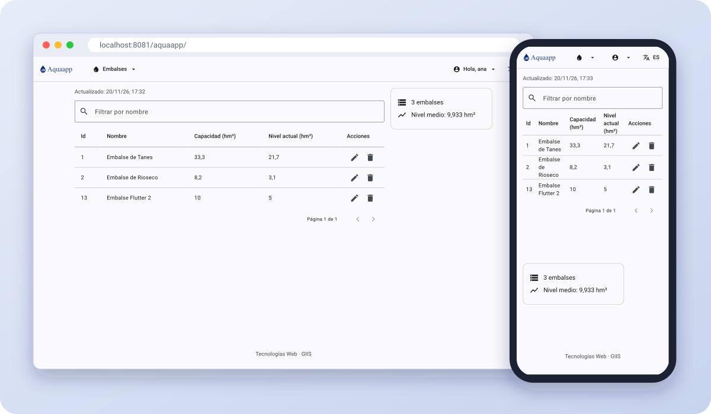
</p>

<p align="center">
  <br/>
  
  
  
  
</p>

<p align="center">
  <br/>
  
  
  
  
  
  
  
  
</p>

<p align="center">
  
</p>

<p align="center">
  <a href="#capturas-de-pantalla"></a>
  <a href="#mapa-de-navegación"></a>
  <a href="#arquitectura"></a>
  <a href="#instalación-y-puesta-en-marcha"></a>
  <a href="#pruebas"></a>
  <a href="#integración-continua"></a>
</p>

## Autor

- [Cristian Augusto](https://github.com/augustocristian)

## Índice

- [Descripción del proyecto](#descripción-del-proyecto)
- [Capturas de pantalla](#capturas-de-pantalla)
- [Estructura del proyecto](#estructura-del-proyecto)
- [Mapa de navegación](#mapa-de-navegación)
- [Arquitectura](#arquitectura)
- [Requisitos previos](#requisitos-previos)
- [Instalación y puesta en marcha](#instalación-y-puesta-en-marcha)
- [Pruebas](#pruebas)
- [Integración continua](#integración-continua)
- [Licencia](#licencia)

## Descripción del proyecto

**aquaapp (variante Angular)** es una reimplementación del cliente web de aquaapp, la aplicación para consultar y
gestionar los embalses de una cuenca. El original es una SPA en HTML5, CSS3 y TypeScript puro con Bootstrap
(`aquaapp-cliente`, en el repositorio `tew-profes-lab-spring`); esta variante ofrece **la misma funcionalidad** con
**Angular 22** (componentes *standalone*, *signals* y detección de cambios *zoneless*) y **Angular Material**
(Material Design 3) en lugar de Bootstrap. Consume la API REST del backend Spring Boot y el servicio de
autenticación en Rust de [`tew-profes-lab-spring`](https://github.com/tew-uniovi/tew-profes-lab-spring).

- **Login y registro** en un único diálogo modal (`MatDialog`, con las acciones «Cancelar» y la principal alineadas a la derecha), con la sesión (JWT) guardada en `sessionStorage`.
- **CRUD de embalses**: listado, alta, edición y borrado contra `/api/embalses`, con el JWT en `Authorization: Bearer`.
- **Listado** con fecha de actualización (`Intl`), filtro por nombre, paginación de 5 en 5 y panel lateral con el
  número de embalses y el nivel medio.
- **Formulario** de alta/edición incrustado en la página (no es un diálogo) con validación reactiva: el nivel actual
  no puede superar la capacidad.
- **Gestión de errores de sesión**: un `401` inesperado (o un token caducado según su claim `exp`) limpia la sesión y
  muestra la vista «Sesión no válida»; un `403` (usuario de solo lectura intentando escribir) muestra un aviso.
- **Tema Material 3** (azul) con **modo claro y oscuro** según el sistema (`color-scheme: light dark`), tipografía Roboto e iconos Material, todo desde tokens `--mat-sys-*`.
- **Selector de idioma** (es/en), con los textos cargados en tiempo de ejecución desde `public/i18n/*.json`
  (las mismas claves que el cliente original) y números y fechas formateados con `Intl`.
- **Despliegue con Docker**: nginx sirve la SPA bajo `/aquaapp/` y hace de proxy inverso de `/api` y `/auth`, de modo
  que el navegador nunca cruza de origen (sin CORS).

## Capturas de pantalla

Capturas en SVG (Chrome → PDF → SVG) sobre la aplicación en marcha, siempre
con la versión de **escritorio** (izquierda) y la de **móvil** (derecha).

<p align="center">
  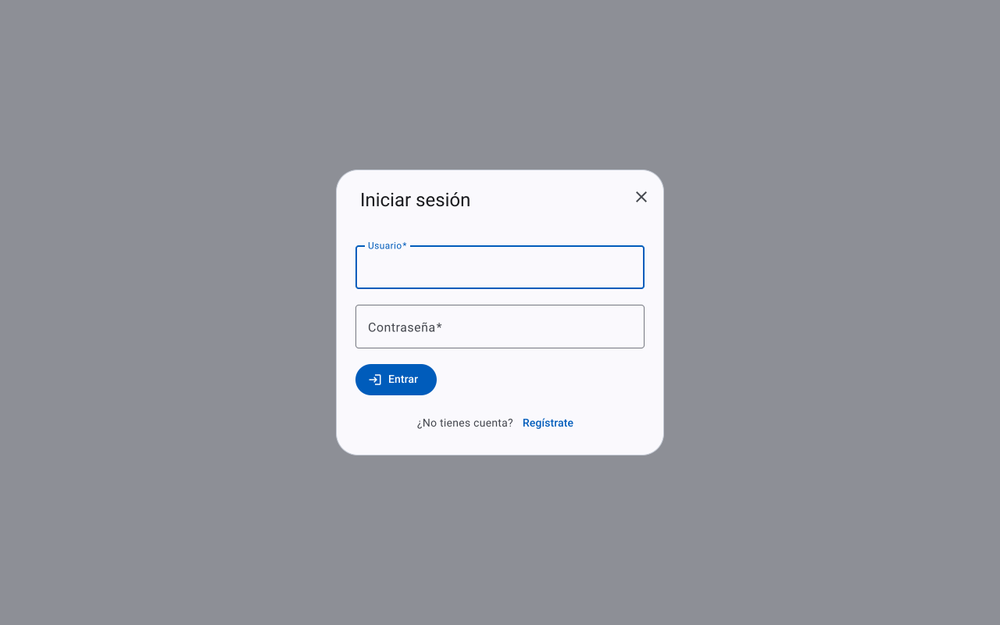
  &nbsp;
  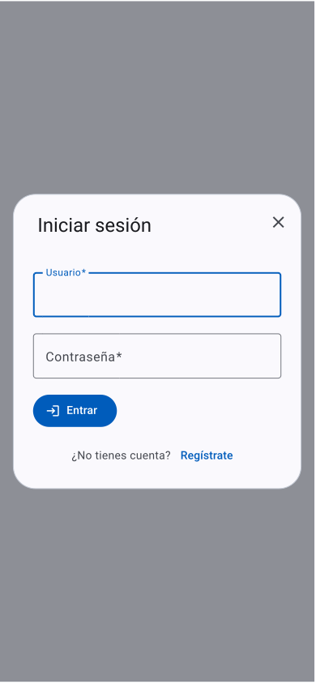
  <br/>
  <em><b>Figura 1 · Inicio de sesión.</b> Sin token en <code>sessionStorage</code> la aplicación arranca con este
  diálogo modal (<code>MatDialog</code>). Siguiendo las convenciones de Material, el título va arriba, los campos en el contenido y,
  en la fila de acciones, «Regístrate» a la izquierda y «Cancelar» y «Entrar» a la derecha. Si las credenciales son
  válidas guarda el JWT y muestra el listado; si no, indica el error en el propio formulario.</em>
</p>

<p align="center">
  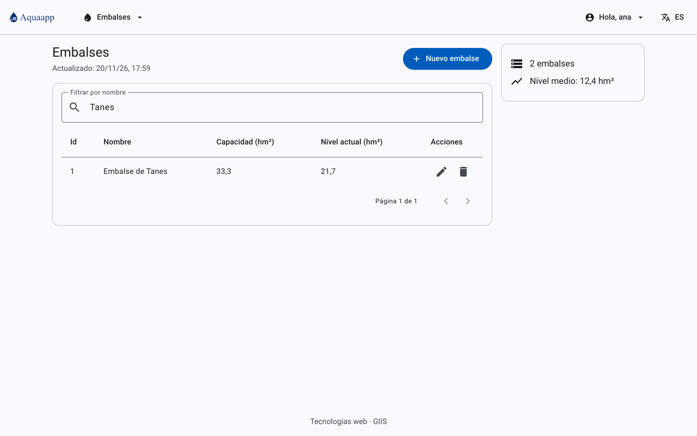
  &nbsp;
  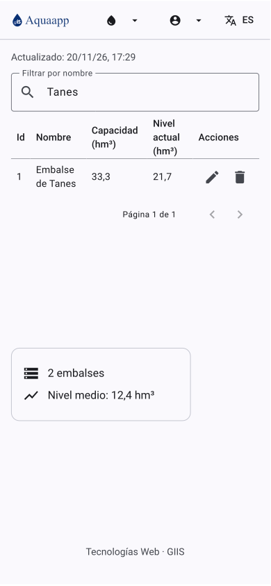
  <br/>
  <em><b>Figura 2 · Listado con filtro.</b> Título de la página con el botón «Nuevo embalse» y, dentro de una tarjeta
  (<code>MatCard</code> con borde), el filtro por nombre ("Tanes") y la tabla de embalses (<code>MatTable</code>) paginada
  de 5 en 5 (<code>MatPaginator</code>). A un lado, otra tarjeta hace de panel lateral con los indicadores (nº de embalses y
  nivel medio). Usuario <code>ana</code> (rol <code>USER</code>).</em>
</p>

<p align="center">
  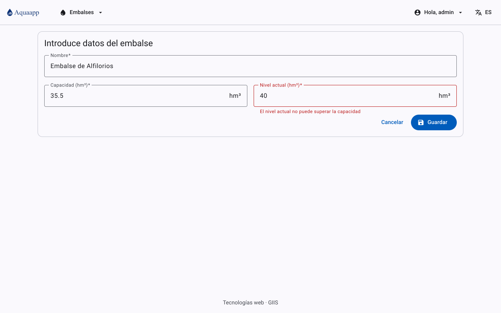
  &nbsp;
  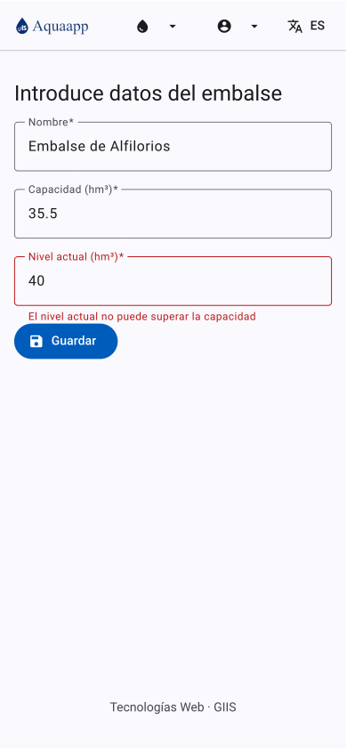
  <br/>
  <em><b>Figura 3 · Alta de embalse.</b> Formulario reactivo en una tarjeta, con campos `outline`, la unidad (hm³) como sufijo y una ayuda
  (<code>mat-hint</code>) bajo el nivel. Aquí el nivel (40 hm³) supera la capacidad (35,5 hm³): el formulario no se envía
  y el error (<code>mat-error</code>) sustituye a la ayuda. El mismo formulario sirve
  para editar un embalse existente.</em>
</p>

<p align="center">
  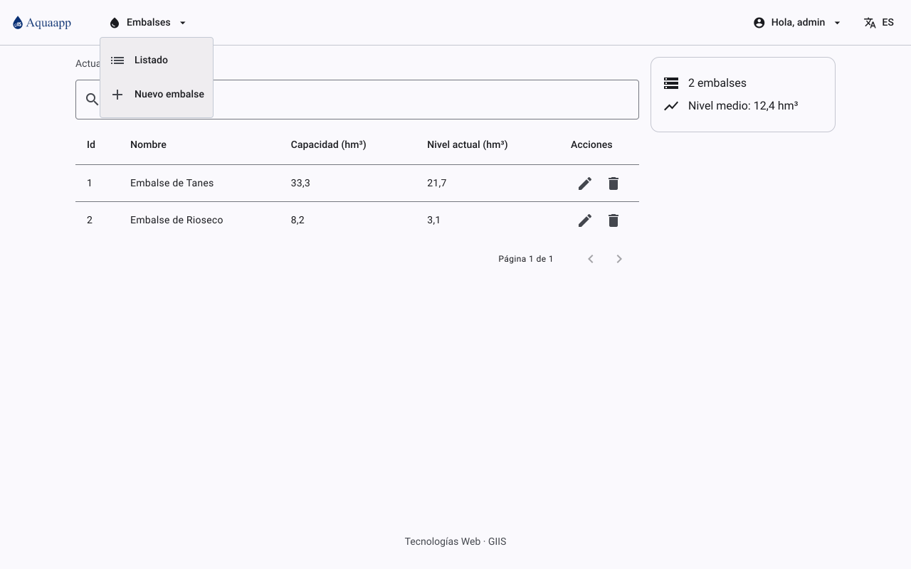
  &nbsp;
  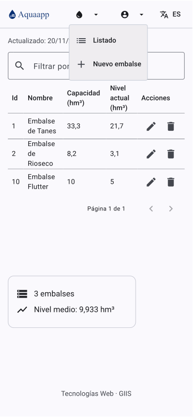
  <br/>
  <em><b>Figura 4 · Menú y panel de indicadores.</b> Sesión del administrador (<code>admin</code>): la barra superior
  muestra el saludo «Hola, admin» y el menú <b>Embalses</b> (<code>MatMenu</code>) con «Listado» y «Nuevo embalse».
  En móvil los menús se reducen a su icono.</em>
</p>

<p align="center">
  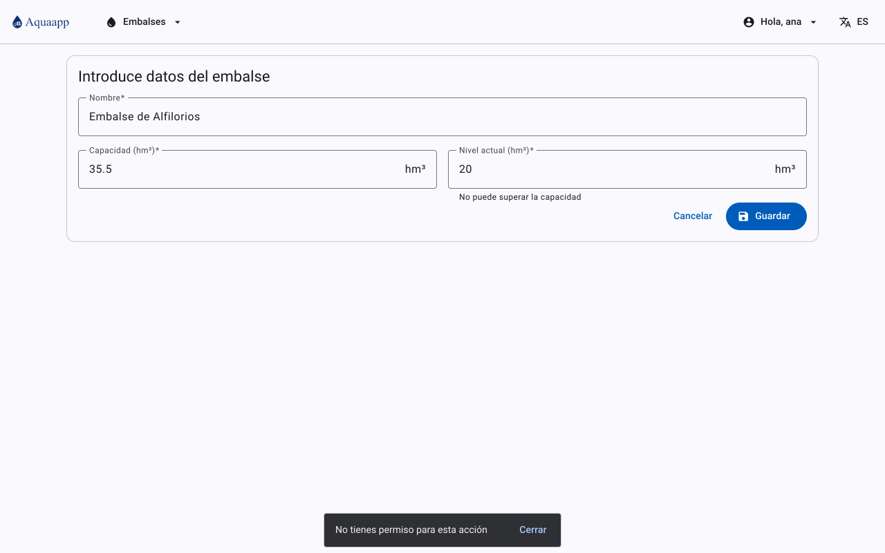
  &nbsp;
  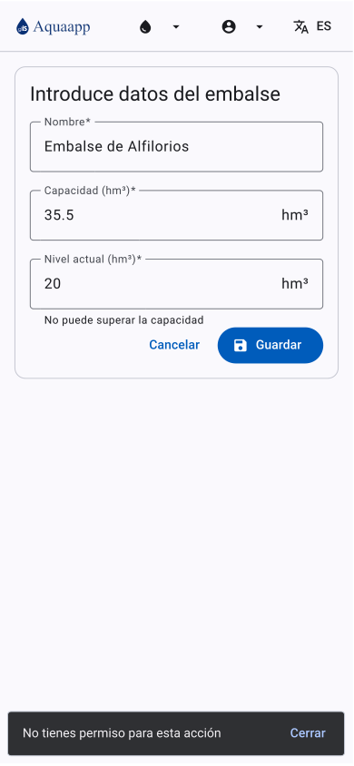
  <br/>
  <em><b>Figura 5 · Error 403.</b> Un usuario de solo lectura (<code>ana</code>) intenta guardar: el backend responde
  <code>403</code> y la aplicación muestra el aviso «No tienes permiso para esta acción» (<code>MatSnackBar</code>, con la acción «Cerrar»)
  sin perder lo escrito en el formulario.</em>
</p>

## Estructura del proyecto

```
📁 aquaapp-frontend-angular/
├── 📁 src/
│   ├── 📁 app/
│   │   ├── 📄 app.ts / app.html / app.css        # Componente raíz: cabecera, <main>, <aside>, pie
│   │   ├── 📄 app.config.ts                      # Proveedores: HttpClient + interceptor, carga inicial de i18n
│   │   ├── 📄 cabecera.*                         # Barra superior: logo, menús Embalses / Cuenta / Idioma
│   │   ├── 📄 listado.*                          # Filtro, tabla paginada y acciones editar/eliminar
│   │   ├── 📄 formulario.*                       # Alta y edición de embalses (formulario reactivo)
│   │   ├── 📄 auth-dialog.*                      # Diálogo de login y registro
│   │   ├── 📄 error-auth.ts                      # Vista «Sesión no válida»
│   │   ├── 📄 panel.ts                           # Panel lateral con los indicadores
│   │   ├── 📄 sesion.service.ts                  # JWT, usuario, caducidad, login y registro
│   │   ├── 📄 embalse.service.ts                 # CRUD contra /api/embalses y estado del listado
│   │   ├── 📄 vista.service.ts                   # Vista activa, diálogo, 401 / 403
│   │   ├── 📄 i18n.service.ts                    # Textos es/en en tiempo de ejecución, Intl
│   │   ├── 📄 auth.interceptor.ts                # Interceptor funcional: cabecera Bearer
│   │   ├── 📄 modelos.ts                         # Interfaces Embalse y Credenciales
│   │   └── 📄 *.spec.ts                          # Pruebas unitarias (Vitest)
│   ├── 📄 index.html                             # title, description y theme-color (claro/oscuro)
│   ├── 📄 main.ts
│   └── 📄 styles.scss                            # Tema Material 3 (azul, claro/oscuro) y estilos globales
├── 📁 public/
│   ├── 📁 i18n/                                  # es.json y en.json (claves del cliente original)
│   ├── 📁 img/                                   # Logo de aquaapp
│   └── 📄 favicon.ico
├── 📁 nginx/
│   └── 📄 default.conf.template                  # Estáticos bajo /aquaapp/ + proxy /api y /auth
├── 📁 img/                                       # Capturas SVG y logos de este README
├── 📄 Dockerfile                                 # Compilación con Node y servidor nginx
├── 📄 proxy.conf.json                            # Proxy de «ng serve» (desarrollo)
├── 📄 angular.json
├── 📄 tsconfig*.json
└── 📄 package.json
```

- 📁 `src/app/` — Un componente *standalone* por pantalla o zona (cabecera, listado, formulario, diálogo, panel) y
  los servicios que guardan el estado en *signals*. No hay *router*: la aplicación tiene una sola URL.
- 📄 `sesion.service.ts` — Guarda el JWT en `sessionStorage["jwt"]`, deduce el usuario del claim `sub` y detecta la
  caducidad con el claim `exp`.
- 📄 `embalse.service.ts` — `HttpClient` contra `/api/embalses` y estado derivado del listado (`computed`: filtrados,
  página actual, total de páginas, nivel medio).
- 📄 `auth.interceptor.ts` — Añade `Authorization: Bearer <jwt>` a las peticiones a `/api/**`.
- 📄 `i18n.service.ts` — Carga `public/i18n/<idioma>.json` con `fetch` del `HttpClient`; el idioma se guarda en
  `localStorage["idioma"]`.
- 📁 `public/i18n/` — Los mismos `es.json` y `en.json` del cliente original, con unas pocas claves nuevas
  (`comun.*`, `error.*`, `form.obligatorio`, `form.minimo`, `form.nivelAyuda`, `listado.vacio`, `listado.porPagina`, `listado.primera`, `listado.ultima`, `nav.idioma`; el pie está en minúscula tras la primera palabra, como pide Material) para que no quede ningún texto fijo en las plantillas.
- 📄 `nginx/default.conf.template` — Plantilla de nginx; el contenedor sustituye `BACKEND_URL` y `AUTH_URL` al
  arrancar.
- 📄 `proxy.conf.json` — Reenvía `/api` y `/auth` durante el desarrollo con `npm start`.

## Mapa de navegación

Diagrama de navegación entre las pantallas de la aplicación:

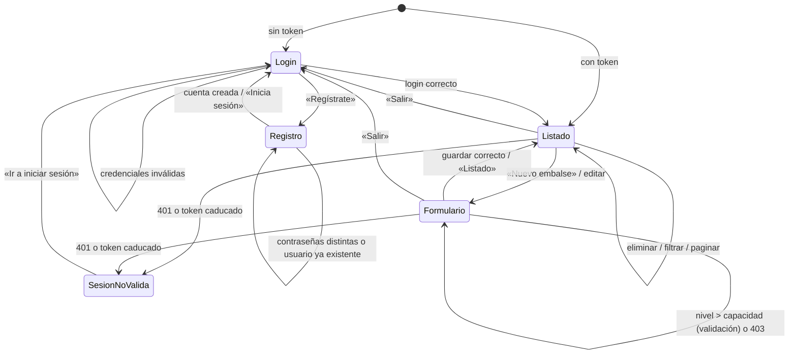

`Login` y `Registro` son el mismo diálogo (`MatDialog`) en dos modos; `Listado`, `Formulario` y `SesionNoValida`
son componentes que se alternan dentro de `<main>` según un *signal* de `VistaService`, sin recargar la página.

## Arquitectura

La SPA se compila a ficheros estáticos que sirve nginx bajo `/aquaapp/`. El mismo nginx actúa de proxy inverso:
`/api/*` va al backend Spring Boot y `/auth/*` (sin el prefijo) al servicio de autenticación en Rust. Los tres
contenedores comparten la red de Docker `aquaapp-network`, y el navegador solo habla con un origen.

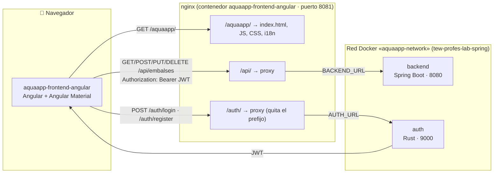

## Requisitos previos

| Herramienta | Versión | Necesaria para |
|---|---|---|
| Node.js | 22.22+, 24.15+ o 26+ (probado con 24) | Compilar y ejecutar la aplicación en desarrollo (`npm start`, `ng build`, `ng test`) |
| Docker | 24+ | Construir la imagen y desplegar con nginx |
| Backend de aquaapp | — | Backend Spring Boot (`backend`) y servicio de autenticación (`auth`) de [`tew-profes-lab-spring`](https://github.com/tew-uniovi/tew-profes-lab-spring) arrancados con Docker en la red `aquaapp-network` |

### Variables de entorno

Las lee el contenedor de nginx (la plantilla `nginx/default.conf.template` pasa por `envsubst` al arrancar):

| Variable | Valor por defecto | Descripción |
|---|---|---|
| `BACKEND_URL` | `http://backend:8080` | URL del backend al que se reenvía `/api/*` |
| `AUTH_URL` | `http://auth:9000` | URL del servicio de autenticación al que se reenvía `/auth/*` (sin el prefijo) |

El `docker-compose.yml` de la raíz del repositorio las pasa a cada variante y publica el puerto con la variable
`ANGULAR_PORT` (por defecto `8081`); ver [`.env.example`](../.env.example).

## Instalación y puesta en marcha

Arranca primero el stack de [`tew-profes-lab-spring`](https://github.com/tew-uniovi/tew-profes-lab-spring) (servicios
`auth` y `backend`) con Docker: crea la red compartida `aquaapp-network`. Usuarios semilla: `ana` / `1234` (rol
`USER`, solo lectura) y `admin` / `admin` (rol `ADMIN`, puede escribir).

### Desarrollo

```bash
cd aquaapp-frontend-angular
npm install
npm start            # ng serve en http://localhost:4200/
```

`ng serve` usa [`proxy.conf.json`](proxy.conf.json): reenvía `/api` a `http://localhost:18080` (el puerto que publica
el backend en el host en este entorno) y `/auth` a `http://localhost:9000` (quitando el prefijo). **Ajusta esos
puertos** si tu backend o tu servicio de autenticación publican otros.

### Despliegue con Docker

La imagen compila la SPA con `--base-href /aquaapp/` y la sirve con nginx. El contenedor debe unirse a la red del
stack Spring para resolver `backend` y `auth`:

```bash
docker build -t aquaapp-frontend-angular .
docker run -d --name aquaapp-angular --network aquaapp-network -p 8081:80 aquaapp-frontend-angular
```

O, desde la raíz del repositorio, con el `docker-compose.yml` (que declara `aquaapp-network` como red externa y levanta
también las otras variantes del cliente si no se indica el servicio):

```bash
docker compose up -d --build angular
```

La aplicación queda en **http://localhost:8081/aquaapp/** (`/` redirige a `/aquaapp/`). Se puede usar otro backend con
`-e BACKEND_URL=... -e AUTH_URL=...`; como nginx resuelve los nombres en tiempo de ejecución, el contenedor arranca
aunque el backend todavía no exista.

## Pruebas

### Pruebas unitarias

```bash
npm test        # ng test: Vitest + jsdom (10 pruebas en 3 ficheros)
```

Cubren la lógica sin interfaz: `SesionService` (token, usuario, caducidad, login), `EmbalseService` (filtro,
paginación de 5, nivel medio, conservar el filtro al recargar) y `authInterceptor` (cabecera `Bearer`, `401` local con
el token caducado, peticiones ajenas a `/api`).

### Pruebas de interfaz

Esta variante no incluye pruebas de interfaz propias: reutiliza las del cliente original, el proyecto Java/Maven
`aquaapp-webtest` de `tew-profes-lab-spring` (JUnit + Selenium WebDriver + Cucumber), que se apuntan a esta aplicación con
la propiedad `baseUrl` (por defecto, `http://localhost/aquaapp/`). Con el stack y este contenedor en marcha:

```bash
cd ../tew-profes-lab-spring/aquaapp-webtest
mvn verify -Pe2e -DbaseUrl=http://localhost:8081/aquaapp/
```

Esas pruebas localizan los elementos por `id` (`usuario`, `password`, `btnLogin`, `modalAuth`, `tabla-embalses`,
`menuEmbalses`, `btnAlta`, `nombre`, `capacidadHm3`, `nivelActualHm3`, `btnGuardar`), que esta variante conserva. Con la base de datos de semilla (menos de 5 embalses) pasan las 5 pruebas
(`EmbalseAltaSystemTest`, `EmbalsesSystemTest` y los dos escenarios de Cucumber: alta correcta y login con credenciales
incorrectas). Ojo: el listado pagina de 5 en 5 (como el original), así que si la base de datos tiene más de 5 embalses el
embalse recién creado cae en la segunda página y `EmbalseAltaSystemTest` no lo encuentra en la tabla.

Además, el flujo completo se comprobó con Playwright: login como `admin`, listado, filtro, alta (incluida la validación
del nivel), edición, borrado, cambio de idioma (y de `<html lang>`), registro con contraseñas distintas, `403` con `ana`
(snackbar y su acción «Cerrar»), `401` con un token caducado, orden del tabulador y trampa de foco en el diálogo, cierre
con «Cancelar» y con Esc, y modo oscuro, sin errores de consola salvo los propios `401`/`403`.

## Integración continua

Esta variante todavía no tiene un *workflow* de GitHub Actions propio (en la raíz del repositorio solo hay
configuración de Dependabot). Los comandos que debería ejecutar son `npm ci`, `npm test` y `npm run build`.

## Licencia

Este proyecto se distribuye bajo licencia [MIT](https://opensource.org/licenses/MIT).

---

<p align="center">
  
  &nbsp;Tecnologías Web - Grado en Ingeniería Informática de Tecnologías de la Información
</p>
