<p align="center">
  
</p>

<p align="center"><i>aquaapp — Gestión de recursos hídricos · Cliente web con Flutter (Material 3)</i></p>

<p align="center">
  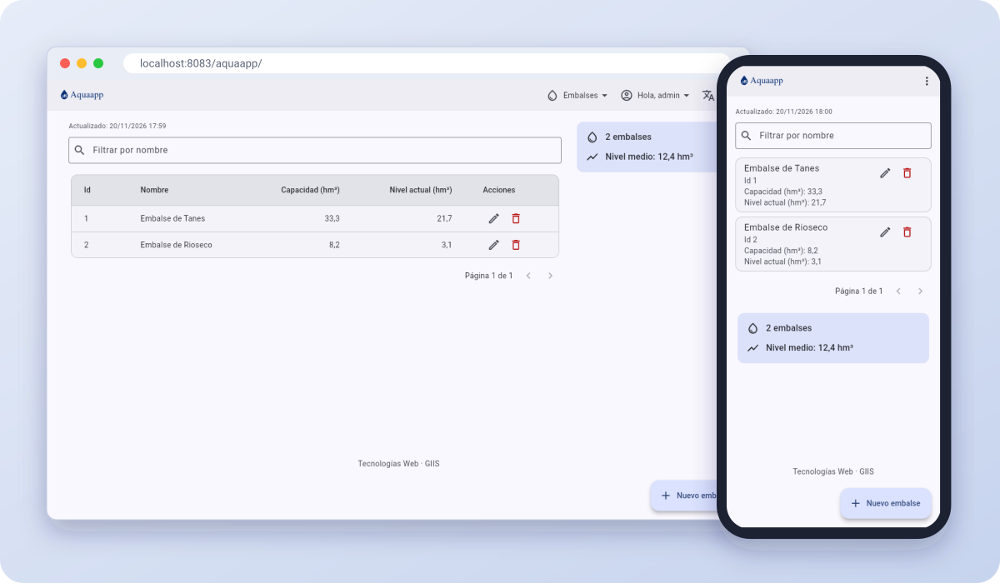
</p>

<p align="center">
  <br/>
  
  
  
  
</p>

<p align="center">
  <br/>
  
  
  
  
  
</p>

<p align="center">
  
</p>

<p align="center">
  <a href="#capturas-de-pantalla"></a>
  <a href="#mapa-de-navegación"></a>
  <a href="#arquitectura"></a>
  <a href="#instalación-y-puesta-en-marcha"></a>
  <a href="#pruebas"></a>
  <a href="#integración-continua"></a>
</p>

## Autor

- [Cristian Augusto](https://github.com/augustocristian)

## Índice

- [Descripción del proyecto](#descripción-del-proyecto)
- [Capturas de pantalla](#capturas-de-pantalla)
- [Estructura del proyecto](#estructura-del-proyecto)
- [Mapa de navegación](#mapa-de-navegación)
- [Arquitectura](#arquitectura)
- [Requisitos previos](#requisitos-previos)
- [Instalación y puesta en marcha](#instalación-y-puesta-en-marcha)
- [Pruebas](#pruebas)
- [Integración continua](#integración-continua)
- [Licencia](#licencia)

## Descripción del proyecto

**aquaapp (Flutter)** es una variante del cliente web de aquaapp —la gestión de embalses del Principado de Asturias—
construida con **Flutter Web**, **Material 3** y los iconos de Flutter (`Icons.*`). Tiene la misma funcionalidad que el
cliente original (`aquaapp-cliente`) (TypeScript + Bootstrap), pero con la
interfaz y las convenciones nativas de Flutter, y consume la API REST del backend Spring Boot y el servicio de
autenticación en Rust de ese mismo proyecto.

- **Login y registro** en un diálogo modal compartido (`AlertDialog`); el registro comprueba que las contraseñas
  coincidan y, tras crear la cuenta, abre el login.
- **Sesión con JWT** guardado en `sessionStorage` (clave `jwt`); el usuario sale del claim `sub` y la caducidad del
  claim `exp` (un token caducado se trata como un 401).
- **CRUD de embalses** contra `/api/embalses` con `Authorization: Bearer`: listado con fecha de actualización, filtro
  por nombre, paginación de 5 en 5, alta y edición en un formulario incrustado (el nivel no puede superar la
  capacidad) y borrado. Tras escribir se recarga el listado conservando filtro y página.
- **Panel de indicadores** con el número de embalses y el nivel medio.
- **Control de errores**: un `401` inesperado limpia la sesión y muestra «Sesión no válida»; un `403` (rol `USER` al
  escribir) muestra un `SnackBar` «No tienes permiso para esta acción».
- **Selector de idioma** (es/en): los textos se cargan en tiempo de ejecución desde `assets/i18n/*.json` (las mismas
  claves que el original) y números y fechas se formatean con `intl`; el idioma se guarda en `localStorage`
  (clave `idioma`) y, por defecto, sale del navegador.
- **Aspecto nativo**: tema claro y oscuro según el sistema, barra superior con menús (`PopupMenuButton`), botón de
  acción flotante «Nuevo embalse», tabla (`DataTable`) en escritorio y lista de tarjetas en móvil (menos de 600 dp),
  y la tipografía Roboto y CanvasKit servidos desde la propia aplicación (sin peticiones a dominios externos).

## Capturas de pantalla

> Capturas en SVG (Chrome → PDF → SVG). **Nota:** Flutter Web con CanvasKit pinta en un
> `<canvas>`, así que el PDF de Chrome lo incrusta como imagen y **estos SVG contienen un bitmap** en vez de
> vectores (limitación del renderizador canvas).

<p align="center">
  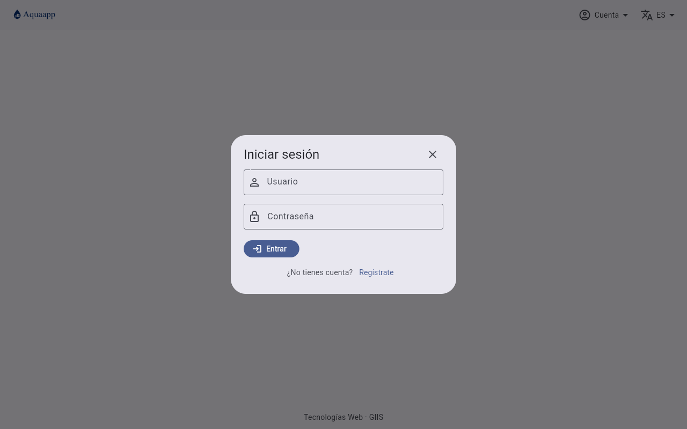
  &nbsp;
  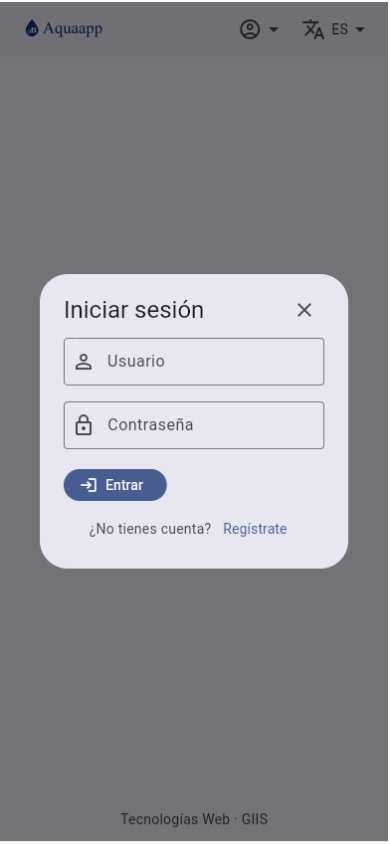
  <br/>
  <em><b>Figura 1 · Inicio de sesión.</b> Sin JWT, la aplicación abre un <code>AlertDialog</code> con usuario y
  contraseña, «Cancelar» y «Entrar»; desde él se pasa al registro con el botón «Regístrate».</em>
</p>

<p align="center">
  
  &nbsp;
  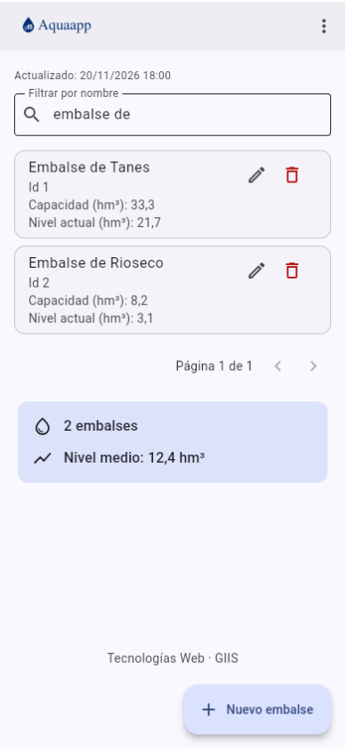
  <br/>
  <em><b>Figura 2 · Listado con filtro.</b> Tabla paginada con el filtro «embalse de»; en escritorio el panel de
  indicadores queda a un lado y en móvil debajo, donde la tabla se sustituye por tarjetas y los menús por un menú de
  desbordamiento.</em>
</p>

<p align="center">
  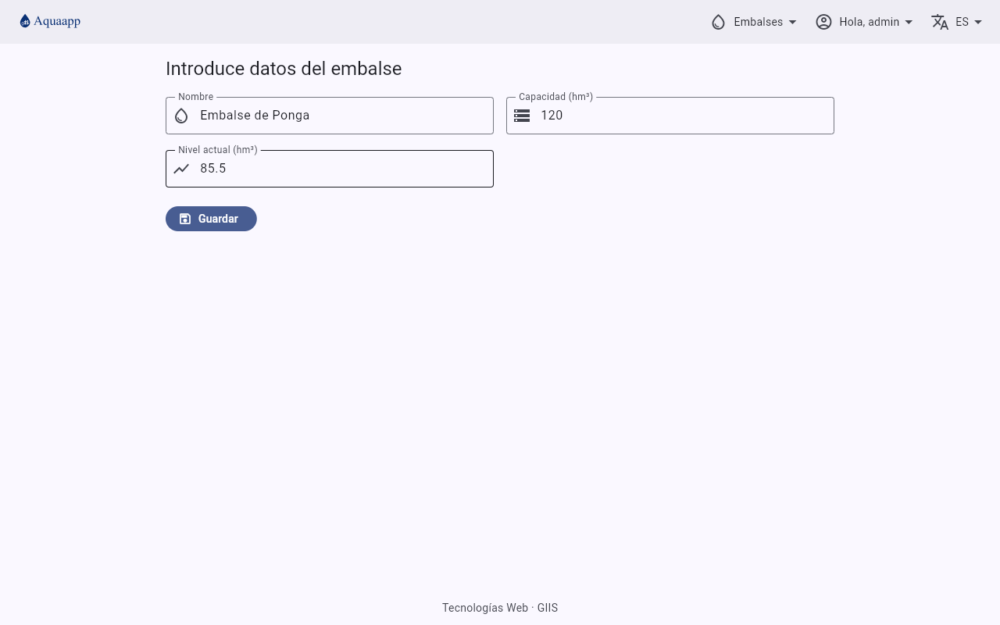
  &nbsp;
  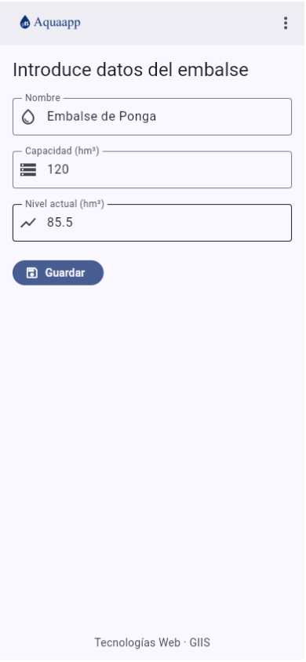
  <br/>
  <em><b>Figura 3 · Alta de un embalse.</b> Formulario incrustado en la vista principal (no es un diálogo), abierto
  con el botón flotante «Nuevo embalse», con validación de campos y de que el nivel no supere la capacidad.</em>
</p>

<p align="center">
  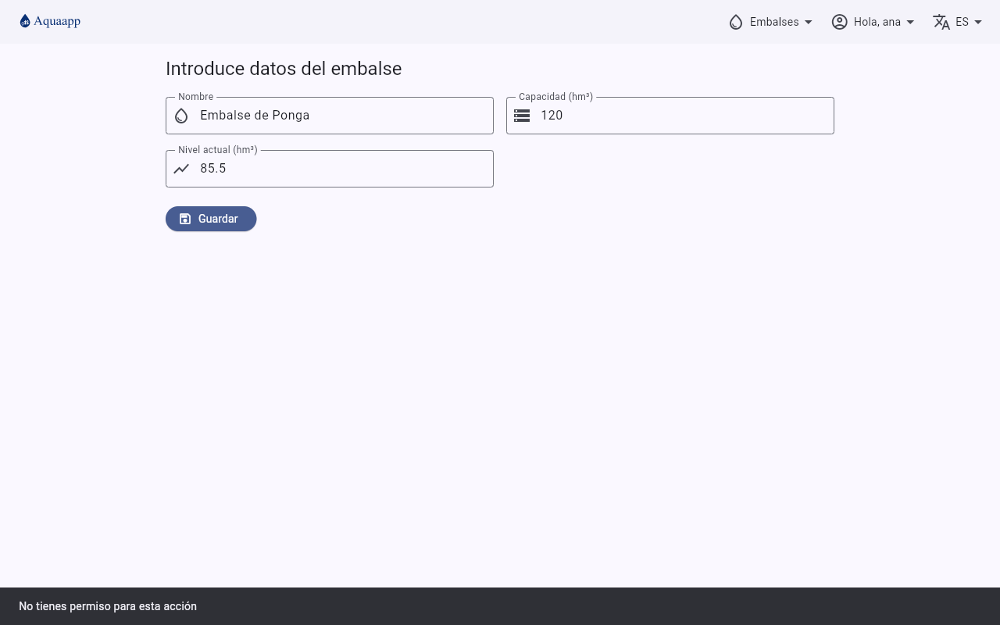
  &nbsp;
  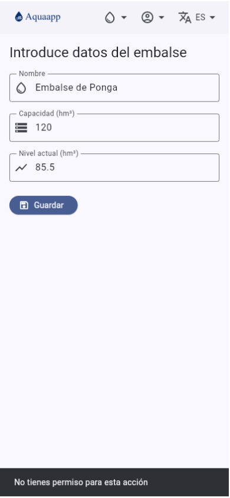
  <br/>
  <em><b>Figura 4 · Sin permiso (403).</b> Con la cuenta <code>ana</code> (rol <code>USER</code>, solo lectura), guardar
  devuelve un 403 del backend y se avisa con un <code>SnackBar</code> con la acción «Cerrar».</em>
</p>

<p align="center">
  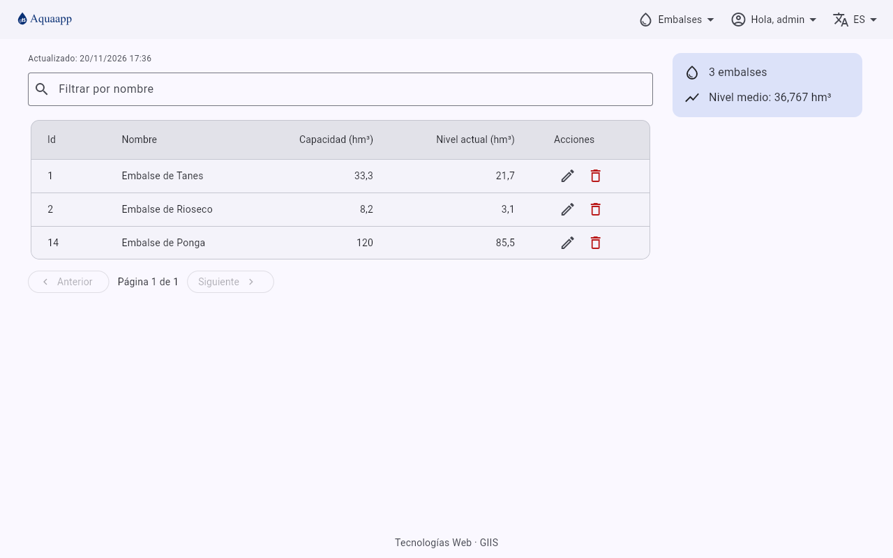
  &nbsp;
  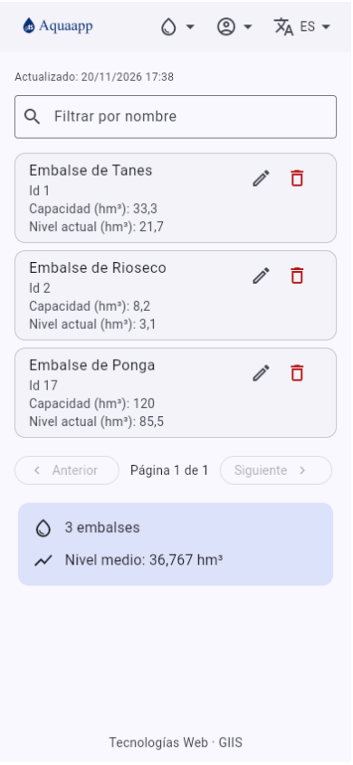
  <br/>
  <em><b>Figura 5 · Embalse creado.</b> Con <code>admin</code> (rol <code>ADMIN</code>), al guardar se recarga el
  listado, que ya incluye el nuevo embalse, y el panel de indicadores se actualiza.</em>
</p>

## Estructura del proyecto

> Las pruebas de extremo a extremo del original viven en `aquaapp-webtest/` (Selenium), fuera de este proyecto.

```
📁 aquaapp-frontend-flutter/
├── 📁 lib/
│   ├── 📁 modelos/
│   ├── 📁 servicios/
│   ├── 📁 estado/
│   ├── 📁 vistas/
│   ├── 📁 widgets/
│   ├── 📁 i18n/
│   ├── 📄 app.dart
│   └── 📄 main.dart
├── 📁 assets/
│   ├── 📁 i18n/
│   ├── 📁 fonts/
│   └── 📄 aquaapp-logo-horizontal.svg
├── 📁 web/
├── 📁 nginx/
│   └── 📄 default.conf.template
├── 📁 test/
├── 📁 img/
├── 📄 Dockerfile
├── 📄 .dockerignore
├── 📄 pubspec.yaml
├── 📄 pubspec.lock
└── 📄 analysis_options.yaml
```

- 📁 `lib/modelos/` — `Embalse` y `ListadoEmbalses` (filtro, paginación y nivel medio, lógica pura sin Flutter)
- 📁 `lib/servicios/` — Clientes HTTP (`AuthApi`, `EmbalsesApi`), lectura del JWT, y la abstracción `Almacen`
  (`sessionStorage`/`localStorage` en `navegador_web.dart`, memoria en los tests)
- 📁 `lib/estado/` — `AppEstado`, un `ChangeNotifier` con la vista actual, la sesión, el idioma y los embalses
- 📁 `lib/vistas/` — Diálogo de login/registro, listado, formulario, «Sesión no válida» y la página principal
- 📁 `lib/widgets/` — Barra de aplicación con sus menús, panel de indicadores, pie, logo y avisos (`SnackBar`)
- 📁 `lib/i18n/` — `Traducciones`: diccionario `clave → texto` cargado con `rootBundle` y formato con `intl`
- 📄 `lib/app.dart` — `MaterialApp` (Material 3, tema claro/oscuro, localización es/en) y `AppScope` (`InheritedNotifier`)
- 📁 `assets/i18n/` — `es.json` y `en.json` del cliente original, más unas pocas claves nuevas (avisos, validación, «Cancelar»)
- 📁 `assets/fonts/` — Roboto (Apache 2.0), incluida para no descargarla de Google Fonts
- 📄 `assets/aquaapp-logo-horizontal.svg` — Logo original con el rótulo convertido a trazados (`flutter_svg` no pinta `<text>`)
- 📁 `web/` — `index.html`, `manifest.json`, favicon original e iconos de la PWA derivados de él
- 📄 `nginx/default.conf.template` — Plantilla de nginx: estáticos bajo `/aquaapp/` y proxy de `/api/` y `/auth/`
- 📁 `test/` — Pruebas unitarias y de widget (`flutter test`)
- 📁 `img/` — Logos y capturas de este README
- 📄 `Dockerfile` — Compilación multi-etapa: imagen de Flutter → nginx

## Mapa de navegación

Navegación real de la aplicación (una sola página; el cuerpo cambia de vista y el login es un diálogo):

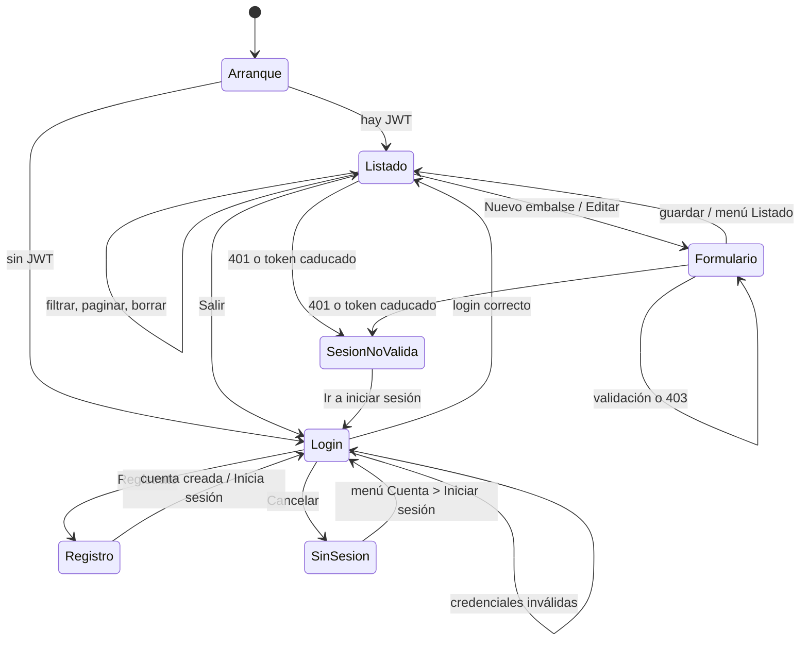

`Login` y `Registro` son el mismo diálogo (`AlertDialog`) que alterna de modo; `SinSesion` es el cuerpo vacío que queda
al cancelar el diálogo sin sesión. El resto son vistas del cuerpo de la página principal.

## Arquitectura

La aplicación se compila a estáticos con `flutter build web --base-href /aquaapp/`; los sirve un nginx que además hace
de proxy inverso de `/api/` hacia el backend y de `/auth/` hacia el servicio de autenticación (quitando el prefijo), de
modo que el navegador solo habla con su propio origen y no hay CORS. Todos los contenedores comparten la red Docker
`aquaapp-network`, que crea el compose del proyecto `YYyy-tew-ZZ-UOXXXXX`.

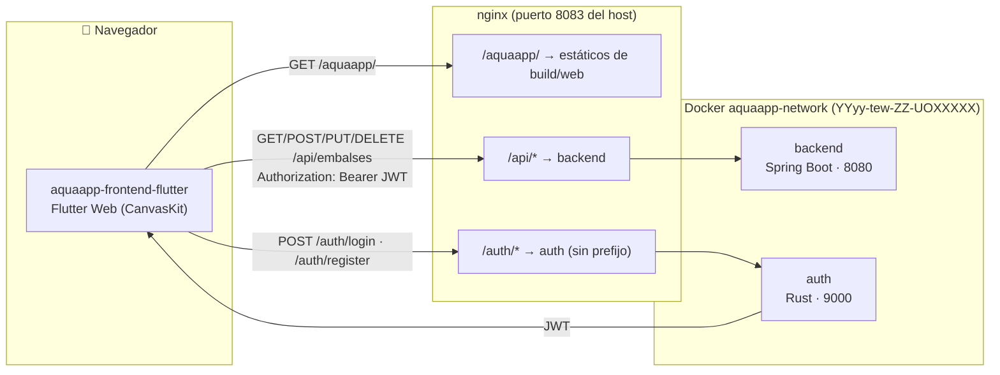

## Requisitos previos

> Estos requisitos complementan a los del backend: el cliente necesita `auth` y `backend` de
> `YYyy-tew-ZZ-UOXXXXX` en marcha (ver su README).

| Herramienta | Versión | Necesaria para |
|---|---|---|
| Docker | 24+ | Construir y ejecutar el cliente, y lanzar `flutter analyze`/`flutter test` sin instalar Flutter |
| Flutter SDK | 3.44 (Dart 3.12) | Solo para desarrollar en local (`flutter run`); el `Dockerfile` ya trae el SDK |
| Backend de aquaapp | — | `auth` (9000) y `backend` (8080), con su compose en la red `aquaapp-network` |

### Variables de entorno

| Variable | Usada por | Valor por defecto | Descripción |
|---|---|---|---|
| `BACKEND_URL` | nginx (`default.conf.template`) | `http://backend:8080` | Destino del proxy de `/api/*` |
| `AUTH_URL` | nginx (`default.conf.template`) | `http://auth:9000` | Destino del proxy de `/auth/*` |

El entrypoint de `nginx:alpine` sustituye solo estas dos variables al arrancar (`NGINX_ENVSUBST_FILTER`), así que las
variables propias de nginx (`$host`, `$uri`...) se conservan. Los nombres se resuelven en cada petición (`resolver
127.0.0.11`): nginx arranca aunque `backend` o `auth` aún no existan.

## Instalación y puesta en marcha

Primero hay que arrancar el backend siguiendo el README de `YYyy-tew-ZZ-UOXXXXX` (su compose crea la red
`aquaapp-network` con los servicios `auth` y `backend`).

### Con Docker (recomendado)

```bash
# Con el docker-compose.yml de la raíz del repositorio (servicio "flutter", puerto 8083)
docker compose up -d --build flutter

# O a mano, sin el compose
docker build -t aquaapp-frontend-flutter aquaapp-frontend-flutter
docker run -d --name aquaapp-flutter --network aquaapp-network -p 8083:80 aquaapp-frontend-flutter
```

La aplicación queda en **http://localhost:8083/aquaapp/** (la raíz `/` redirige ahí). Usuarios semilla del backend:

| Usuario | Contraseña | Rol |
|---|---|---|
| `ana` | `1234` | `USER` (solo lectura) |
| `admin` | `admin` | `ADMIN` (puede escribir) |

### Desarrollo con el SDK de Flutter

```bash
cd aquaapp-frontend-flutter
flutter pub get
flutter run -d chrome
```

La app llama a rutas del mismo origen (`/api/embalses`, `/auth/login`...), que `flutter run` no proxifica: el servicio
de autenticación tiene CORS permisivo, pero el backend no, y habría que resolver el proxy a mano. Por eso se recomienda
Docker, cuyo nginx ya lo hace.

## Pruebas

Las pruebas unitarias y de widget cubren el diccionario i18n y el formato de números y fechas, la lectura del JWT
(`sub`, `exp`), el filtro y la paginación, y los flujos de la interfaz con un backend simulado (login, registro, listado,
validación del formulario, 401, 403, token caducado, idioma y diseño móvil). Se ejecutan sin instalar Flutter:

```bash
cd aquaapp-frontend-flutter
docker run --rm -v "$PWD:/app" -w /app ghcr.io/cirruslabs/flutter:3.44.0 flutter analyze
docker run --rm -v "$PWD:/app" -w /app ghcr.io/cirruslabs/flutter:3.44.0 flutter test
```

Las pruebas de sistema viven en `E2E/`, en la raíz del repositorio: una única suite de Playwright que se ejecuta igual
contra los tres clientes (Angular, React y Flutter). Localiza los controles por identificador de prueba: en Angular y
React es `data-testid`; en Flutter Web son `Semantics(identifier: '...')`, que Flutter vuelca al DOM de semántica como
atributo `flt-semantics-identifier` (la suite configura `testIdAttribute: 'flt-semantics-identifier'`). La app activa el
árbol de accesibilidad (`SemanticsBinding.ensureSemantics()`) y marca `data-listo` en `<body>` cuando cada vista está
pintada. Con el stack levantado (`docker compose up -d --build`), se lanzan con:

```bash
cd E2E && npm ci && npx playwright test --project=flutter
```

## Integración continua

Aún no hay un workflow de GitHub Actions para esta variante. Solo hay actualizaciones mensuales de dependencias con
Dependabot (`pub` y `docker`, en `.github/dependabot.yml`).

## Licencia

Este proyecto se distribuye bajo licencia [MIT](https://opensource.org/licenses/MIT).

---

<p align="center">
  
  &nbsp;Tecnologías Web - Grado en Ingeniería Informática de Tecnologías de la Información
</p>
