<p align="center">
  
</p>

<p align="center"><i>aquaapp — Gestión de recursos hídricos · Cliente web con React y Material UI</i></p>

<p align="center">
  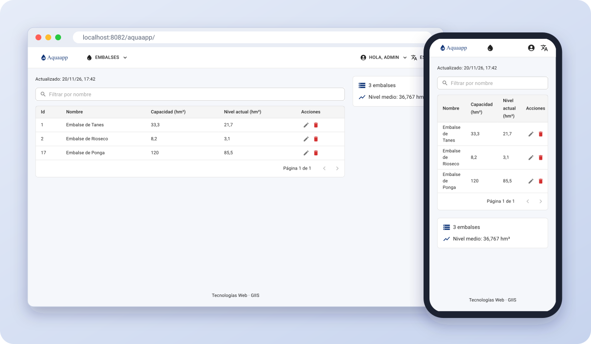
</p>

<p align="center">
  <br/>
  
  
  
  
</p>

<p align="center">
  <br/>
  
  
  
  
  
  
  
  
</p>

<p align="center">
  
</p>

<p align="center">
  <a href="#capturas-de-pantalla"></a>
  <a href="#mapa-de-navegación"></a>
  <a href="#arquitectura"></a>
  <a href="#instalación-y-puesta-en-marcha"></a>
  <a href="#pruebas"></a>
  <a href="#integración-continua"></a>
</p>

## Autor

- [Cristian Augusto](https://github.com/augustocristian)

## Índice

- [Descripción del proyecto](#descripción-del-proyecto)
- [Capturas de pantalla](#capturas-de-pantalla)
- [Estructura del proyecto](#estructura-del-proyecto)
- [Mapa de navegación](#mapa-de-navegación)
- [Arquitectura](#arquitectura)
- [Requisitos previos](#requisitos-previos)
- [Instalación y puesta en marcha](#instalación-y-puesta-en-marcha)
- [Pruebas](#pruebas)
- [Integración continua](#integración-continua)
- [Licencia](#licencia)

## Descripción del proyecto

**aquaapp (React)** es una de las variantes del cliente web de aquaapp, la aplicación de gestión de recursos
hídricos del Principado de Asturias de la práctica de Tecnologías Web. Es una SPA construida con **React 19,
TypeScript y Vite**, con la interfaz en **Material UI (MUI)**, que reproduce la funcionalidad del cliente original
(HTML + TypeScript sin framework, en `aquaapp-cliente` de `YYyy-tew-ZZ-UOXXXXX`) y consume la misma API REST: el
backend Spring Boot (embalses) y el servicio de autenticación en Rust, ambos del repositorio `YYyy-tew-ZZ-UOXXXXX`.

- **Login y registro** en un único diálogo modal; el JWT se guarda en `sessionStorage` (clave `jwt`), el usuario se
  lee del claim `sub` y la caducidad del claim `exp`.
- **CRUD de embalses** contra `/api/embalses` con `Authorization: Bearer`: listado, alta, edición y borrado.
- **Listado** con fecha de actualización formateada con `Intl`, filtro por nombre, paginación de 5 en 5 (`TablePagination`)
  y panel lateral con el número de embalses y el nivel medio.
- **Formulario de alta/edición** incrustado en la página (no es un modal), con validación: el nivel actual no puede
  superar la capacidad.
- **Gestión de errores de sesión y permisos**: un `401` inesperado limpia la sesión y muestra la vista «Sesión no
  válida»; un `403` (usuario `USER`, solo lectura) muestra «No tienes permiso para esta acción».
- **Aspecto Material Design** con MUI: tema derivado del azul del logo, que sigue el modo claro u oscuro del sistema
  (`prefers-color-scheme`), y tipografía Roboto autoalojada.
- **Selector de idioma** (es/en): los textos se cargan en tiempo de ejecución desde `public/i18n/*.json` (los
  mismos ficheros del cliente original) y el idioma se recuerda en `localStorage`.
- **Contenedor Docker** (multi-stage: Node → Nginx) que sirve la SPA bajo `/aquaapp/` y hace de proxy inverso de
  `/api/*` hacia el backend y de `/auth/*` hacia el servicio de autenticación.

Es una de las tres variantes del cliente (Angular, React y Flutter) que viven en el repositorio
`frameworks-examples`.

## Capturas de pantalla

> Capturas en **SVG** (vectorial) generadas con Chrome → PDF → SVG, con el stack arrancado y en español. Muestran la versión de **escritorio** (izquierda) y la
> de **móvil** (derecha).

<p align="center">
  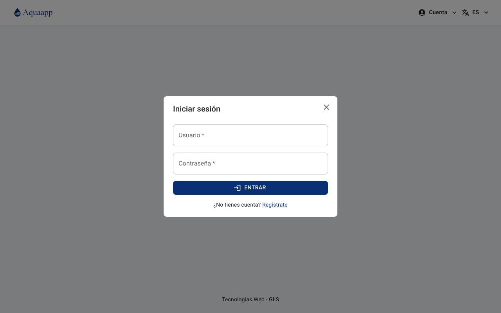
  &nbsp;
  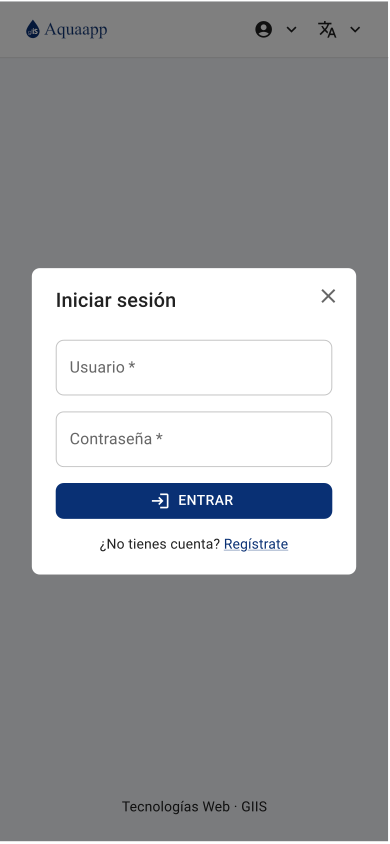
  <br/>
  <em><b>Figura 1 · Inicio de sesión.</b> Al arrancar sin token se abre el diálogo de login (<code>Dialog</code> de
  MUI con <code>DialogActions</code>: «Cancelar» y «Entrar»), compartido con el registro. Si las credenciales son
  válidas guarda el JWT y pasa al listado; si no, muestra el error en el propio formulario.</em>
</p>

<p align="center">
  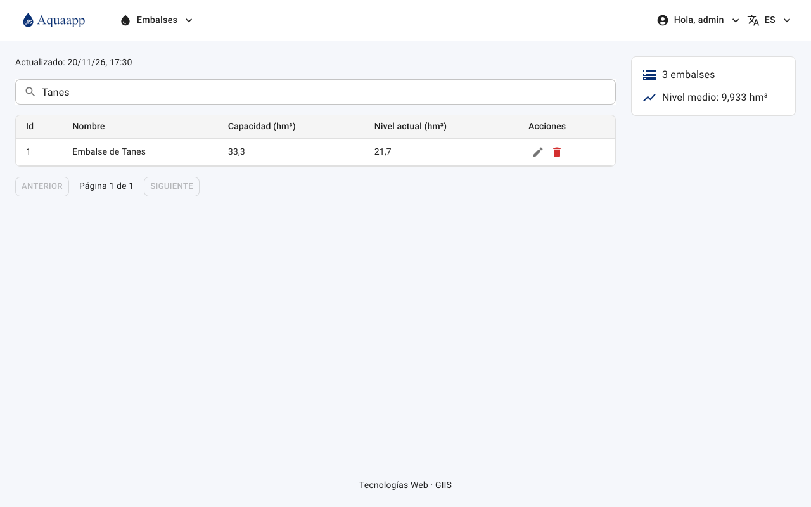
  &nbsp;
  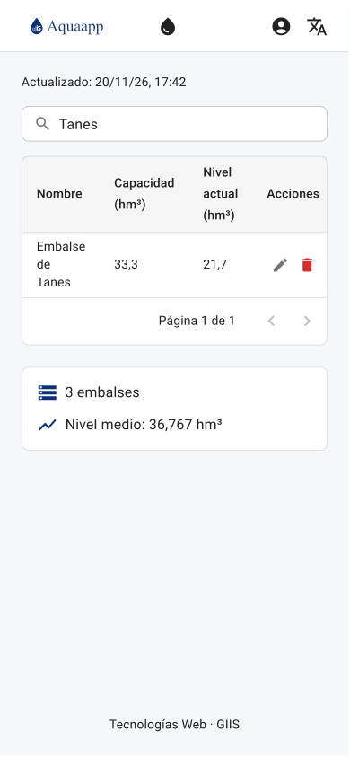
  <br/>
  <em><b>Figura 2 · Listado con filtro por nombre.</b> Tabla de embalses con filtro, paginación de 5 en 5
  (<code>TablePagination</code>, «Página X de Y» y flechas con nombre accesible), botones de editar y eliminar
  (<code>IconButton</code> con <code>Tooltip</code> y <code>aria-label</code>) y, a la derecha, el panel con el
  número de embalses y el nivel medio. En móvil el panel pasa debajo de la tabla, se oculta la columna Id y los
  menús de la barra quedan reducidos a iconos con <code>Tooltip</code>.</em>
</p>

<p align="center">
  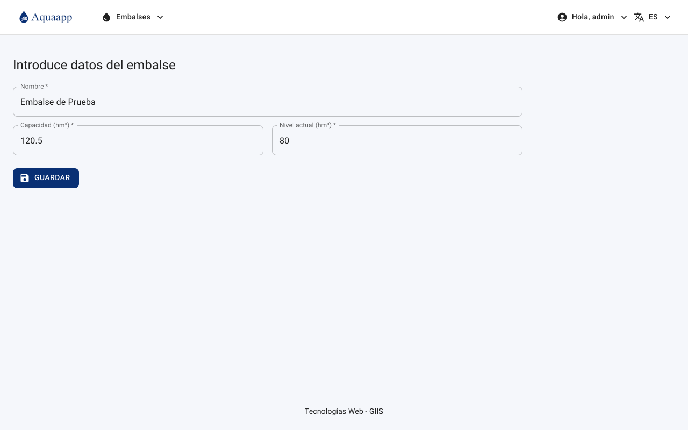
  &nbsp;
  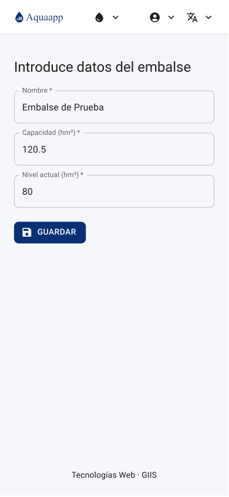
  <br/>
  <em><b>Figura 3 · Alta de embalse.</b> El formulario se incrusta en la página (no es un modal) y sirve también
  para editar. Valida que el nivel actual no supere la capacidad antes de enviar.</em>
</p>

<p align="center">
  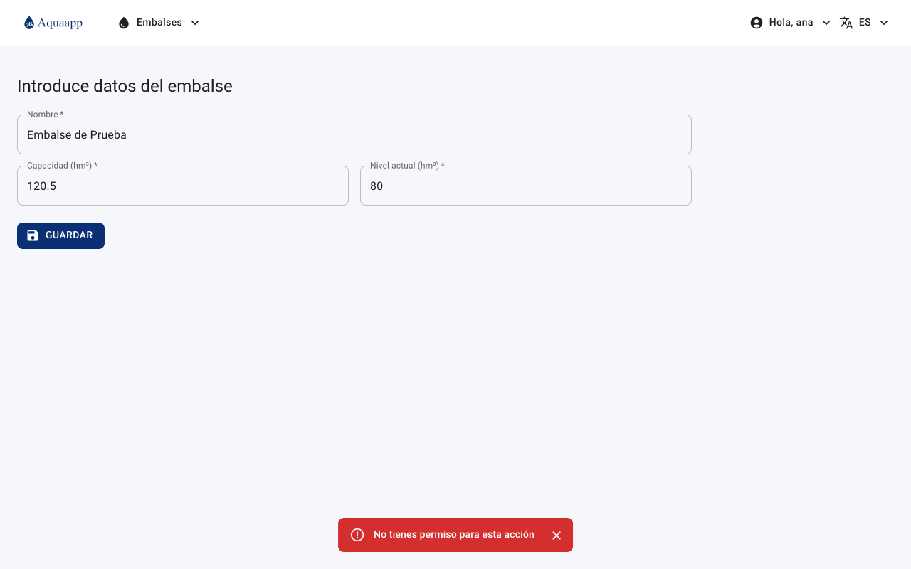
  &nbsp;
  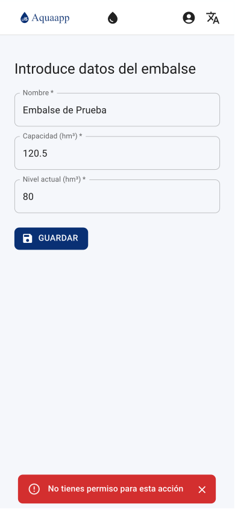
  <br/>
  <em><b>Figura 4 · Permisos (403).</b> El usuario <code>ana</code> (rol <code>USER</code>, solo lectura) intenta
  guardar un embalse: el backend responde 403 y el cliente muestra un <code>Snackbar</code> con un
  <code>Alert</code> («No tienes permiso para esta acción») y un botón para cerrarlo.</em>
</p>

<p align="center">
  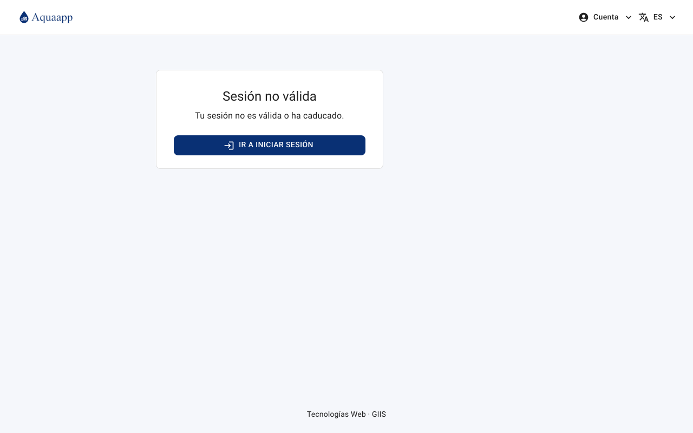
  &nbsp;
  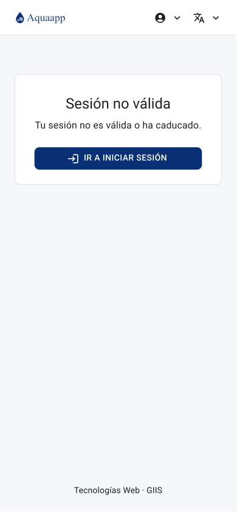
  <br/>
  <em><b>Figura 5 · Sesión no válida.</b> Si el backend responde 401 a una petición con un token que el cliente
  creía vigente (firma incorrecta, secreto cambiado...), se limpia la sesión y se ofrece volver al login.</em>
</p>

## Estructura del proyecto

```
📁 aquaapp-frontend-react/
├── 📁 src/
│   ├── 📁 api/              # fetch tipado: auth, embalses, token, ErrorApi
│   ├── 📁 components/       # BarraNavegacion, MenuBoton, DialogoAuth, PanelIndicadores
│   ├── 📁 views/            # ListadoView, FormularioView, ErrorAuthView
│   ├── 📁 context/          # Contextos de sesión (JWT) e i18n y sus providers
│   ├── 📁 hooks/            # useEmbalses, useListado, useBodyListo
│   ├── 📁 utils/            # Funciones puras: jwt, i18n (Intl), filtro y paginación
│   ├── 📁 assets/           # Logo de aquaapp
│   ├── 📁 test/             # Utilidades de las pruebas (setup, JWT falso, render con i18n)
│   ├── 📄 App.tsx
│   ├── 📄 main.tsx
│   └── 📄 tema.ts
├── 📁 public/
│   ├── 📁 i18n/             # es.json y en.json (cargados en tiempo de ejecución)
│   └── 📄 favicon.ico
├── 📁 nginx/
│   └── 📄 default.conf.template
├── 📁 img/                  # Logos y capturas (SVG) de este README
├── 📄 index.html
├── 📄 vite.config.ts
├── 📄 tsconfig.json         # (+ tsconfig.app.json y tsconfig.node.json)
├── 📄 .oxlintrc.json
├── 📄 Dockerfile
├── 📄 .dockerignore
└── 📄 package.json
```

- 📁 `api/` — Módulo de acceso a la API: `http.ts` (`apiFetch`, que adjunta el JWT y lanza `ErrorApi` si la respuesta no es 2xx), `embalses.ts` (CRUD), `auth.ts` (login y registro) y `token.ts` (`sessionStorage`)
- 📁 `components/` — Piezas de interfaz reutilizables con MUI: `AppBar` con menús (`Menu`/`MenuItem`), diálogo de login/registro y panel de indicadores
- 📁 `views/` — Las pantallas que se muestran en `<main>`: listado, formulario de alta/edición y «sesión no válida»
- 📁 `context/` — `SesionProvider` (usuario y JWT) e `I18nProvider` (textos, idioma y formato `Intl`), con sus hooks `useSesion` y `useI18n`
- 📁 `hooks/` — `useEmbalses` (datos y operaciones CRUD), `useListado` (filtro y paginación) y `useBodyListo` (atributo `data-listo`)
- 📁 `utils/` — Lógica sin React, fácil de probar: lectura del JWT, idioma inicial y formatos, filtrado y paginación
- 📁 `public/i18n/` — Los `es.json` y `en.json` del cliente original (más claves nuevas: `error.sinPermiso`, `error.servidor`, `comun.cerrar`, `comun.cancelar`, `nav.idioma` y `app.descripcion`)
- 📁 `nginx/` — Plantilla de Nginx: estáticos bajo `/aquaapp/` y proxy de `/api/` y `/auth/`
- 📄 `src/tema.ts` — Tema de MUI (`createTheme` con variables CSS y esquemas claro/oscuro) a partir del azul del logo
- 📄 `Dockerfile` — Imagen multi-stage: `node` compila con Vite y `nginx:alpine` sirve el resultado
- 📄 `vite.config.ts` — `base: '/aquaapp/'`, proxy de desarrollo (`/api`, `/auth`) y configuración de Vitest

## Mapa de navegación

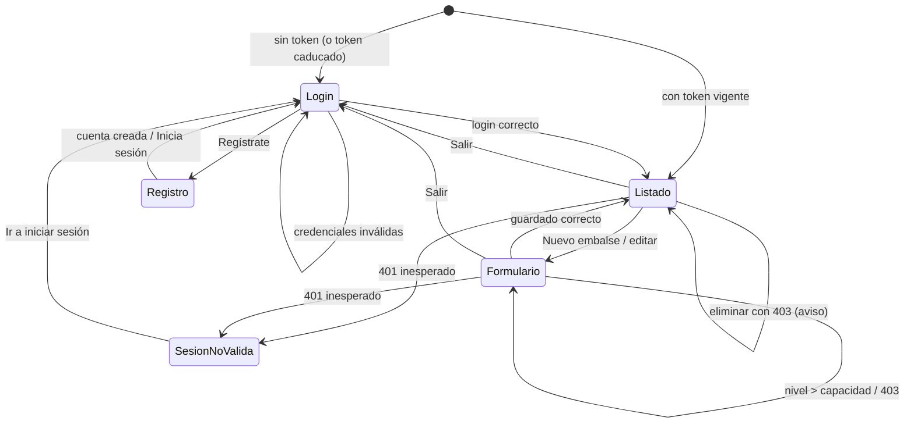

Cada estado es una vista (o el diálogo de autenticación) dentro de la misma página: no hay recarga ni *router*.
`Login` y `Registro` son el mismo `Dialog` de MUI con distinto contenido; `Listado`, `Formulario` y `SesionNoValida`
se pintan en `<main>` (el panel de indicadores solo aparece con el listado). Las transiciones de «Nuevo embalse»,
«Listado» y «Salir» salen de los menús de la barra superior.

## Arquitectura

La SPA se compila a ficheros estáticos y los sirve Nginx, que además actúa de proxy inverso: `/api/*` va al
backend Spring Boot y `/auth/*` al servicio de autenticación (quitando el prefijo `/auth`). Así el navegador solo
habla con un origen y no hay problemas de CORS. Nginx se une a la red de Docker del stack de `YYyy-tew-ZZ-UOXXXXX`
(`aquaapp-network`) para resolver los servicios `backend` y `auth` por nombre.

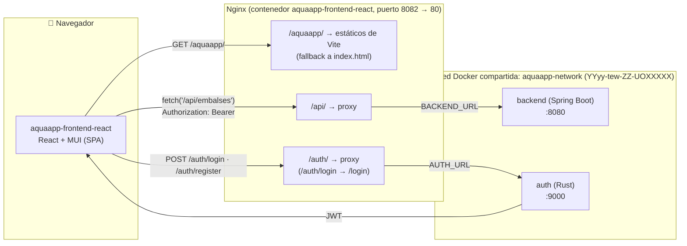

## Requisitos previos

| Herramienta | Versión | Necesaria para |
|---|---|---|
| Node.js | 24 (la versión con la que se ha probado) | `npm run dev`, build, lint y pruebas |
| Docker | 24+ | Construir y ejecutar la imagen (Nginx) |
| Stack de `YYyy-tew-ZZ-UOXXXXX` | — | La SPA necesita `auth` y `backend` arrancados (`docker compose up -d --build` en ese repositorio), que crea la red `aquaapp-network` |

### Variables de entorno

| Variable | Usada por | Valor por defecto | Descripción |
|---|---|---|---|
| `BACKEND_URL` | Nginx (contenedor) y `vite.config.ts` (`npm run dev`) | `http://backend:8080` (contenedor) · `http://localhost:8080` (dev) | URL del backend al que se reenvía `/api/*` |
| `AUTH_URL` | Nginx (contenedor) y `vite.config.ts` (`npm run dev`) | `http://auth:9000` (contenedor) · `http://localhost:9000` (dev) | URL del servicio de autenticación al que se reenvía `/auth/*` |

En el contenedor, Nginx sustituye `BACKEND_URL` y `AUTH_URL` en la plantilla `nginx/default.conf.template` al
arrancar (`envsubst`). En desarrollo, el proxy de Vite las lee del entorno o de un fichero `.env.local`
(p. ej. `BACKEND_URL=http://localhost:18080 npm run dev` si el 8080 de tu máquina está ocupado).

## Instalación y puesta en marcha

Arranca primero el stack de `YYyy-tew-ZZ-UOXXXXX` (servicios `auth` y `backend`), que crea la red
`aquaapp-network`; después, la SPA con una de estas dos opciones.

**Desarrollo** (Vite con recarga en caliente y proxy hacia `localhost`):

```bash
cd aquaapp-frontend-react
npm install
npm run dev            # http://localhost:5173/aquaapp/
```

**Despliegue con Docker** (Nginx en la red del stack):

```bash
# Desde la raíz del repositorio
docker build -t aquaapp-frontend-react aquaapp-frontend-react
docker run -d --name aquaapp-react \
  --network aquaapp-network -p 8082:80 aquaapp-frontend-react
```

También se puede levantar con el [`docker-compose.yml`](../docker-compose.yml) de la raíz del repositorio, que
declara `aquaapp-network` como red externa y publica la variante React en el puerto 8082 (variable `REACT_PORT`):
`docker compose up -d --build react`.

La aplicación queda disponible en **http://localhost:8082/aquaapp/** (`/` redirige ahí). Usuarios semilla del
servicio de autenticación:

| Usuario | Contraseña | Rol | Permisos |
|---|---|---|---|
| `ana` | `1234` | `USER` | Solo lectura (las escrituras devuelven 403) |
| `admin` | `admin` | `ADMIN` | Lectura y escritura |

Nginx arranca aunque `backend` o `auth` no existan todavía (resuelve sus nombres en cada petición): hasta que
aparezcan, `/api/` y `/auth/` responden `502`.

## Pruebas

```bash
npm run lint     # oxlint (reglas de React y TypeScript)
npm test         # Vitest + Testing Library (22 pruebas)
npm run build    # tsc -b (TypeScript estricto) + vite build
```

Las **pruebas unitarias** (Vitest, entorno `jsdom`) cubren lo que tiene lógica propia:

- `utils/jwt` — lectura del usuario (`sub`) y de la caducidad (`exp`) del token, incluidos tokens mal formados.
- `utils/i18n` — idioma inicial (guardado o del navegador), traducción con clave ausente y formatos `Intl`.
- `utils/listado` y `hooks/useListado` — filtro por nombre, paginación de 5 en 5 (página destino que entrega `TablePagination`, total filtrado), página fuera de rango y nivel medio.
- `api/embalses` — método, ruta y cabecera `Authorization: Bearer` de cada operación (con `fetch` simulado), propagación del 403 y token caducado tratado como 401 sin llamar al servidor.
- `views/FormularioView` — validación «nivel ≤ capacidad» y envío con `id: null` (alta) o con el `id` (edición).

Además, el flujo completo (login, orden de tabulación del diálogo, listado, paginación, alta, edición, borrado, cambio de
idioma, 403 con `ana`, registro, 401, token caducado y modo oscuro) se ha verificado en un Chrome real con Playwright contra el contenedor y el stack Spring.

Las **pruebas de sistema** de esta variante viven en la carpeta [`E2E/`](../E2E) de la raíz del repositorio: una única suite de Playwright que se ejecuta igual contra los tres clientes (Angular, React y Flutter). Para ello el cliente expone atributos `data-testid` (`menu-sesion`, `auth-usuario`, `auth-enviar`, `listado-tabla`, `fila-embalse-<id>`, `form-guardar`, `aviso`...) en los elementos con los que interactúa la suite, sin quitar los `id` existentes. Con el stack levantado (`docker compose up -d --build` en la raíz):

```bash
cd E2E && npm ci && npx playwright test --project=react
```

Las pruebas de sistema del cliente original (`aquaapp-webtest`, Selenium + Cucumber) son independientes del
framework: solo necesitan una URL base. Esta variante conserva los identificadores que usan (`usuario`,
`password`, `btnLogin`, `menuEmbalses`, `btnAlta`, `nombre`, `capacidadHm3`, `nivelActualHm3`, `btnGuardar`,
`tabla-embalses`, `mensaje-error`...), de modo que se pueden apuntar a ella con
`mvn verify -Pe2e -DbaseUrl=http://localhost:8082/aquaapp/` (propiedad `baseUrl` de ese proyecto). Esa
ejecución no forma parte de las comprobaciones hechas aquí.

## Integración continua

Esta variante **todavía no tiene un workflow de GitHub Actions**. Cuando se añada, bastaría con `npm ci`,
`npm run lint`, `npm test`, `npm run build` y la construcción de la imagen Docker.

## Licencia

Este proyecto se distribuye bajo licencia [MIT](https://opensource.org/licenses/MIT).

---

<p align="center">
  
  &nbsp;Tecnologías Web - Grado en Ingeniería Informática de Tecnologías de la Información
</p>
